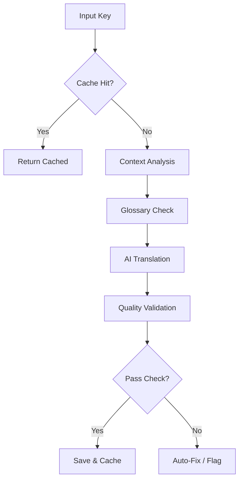

# Core Concepts

Locai is more than just a wrapper around an API; it contains several intelligent systems to ensure human-quality localization.

## Translation Pipeline

Locai processes every key through a robust pipeline to ensure quality and consistency.



## 1. Vector Memory (optional)

Vector memory is off unless you set `vectorMemory.enabled: true`. When it is on, Locai creates an OpenAI embedding for each source string and stores the translation in a local vector database (`vectorDbPath`). Before translating a string, it looks for a stored one with similar meaning for the same target language:

- Similarity ≥ `exactMatchThreshold` (default 0.98): the stored translation is reused and no translation call is made.
- Similarity ≥ `similarityThreshold` (default 0.85): the stored translation is given to the model as a reference; the translation call still happens.

Only OpenAI embeddings are supported (`embeddingProvider: "openai"`), so `OPENAI_API_KEY` must be set. With any other provider, vector memory does nothing. Each new string costs at least one embedding request. The database uses 1536-dimension vectors, which matches `text-embedding-3-small` (the default model); models with a different output size do not work.

## Deep Context (Source Code Analysis)

Unlike traditional tools that only see the key and value, LocAI scans your source code (TypeScript/TSX) to understand **where** and **how** a string is used.

It extracts:

- **Component Name**: Knowing it's in a `DeleteModal` vs `SuccessToast` changes the tone.
- **Comments**: Reads comments like `// context: shown to admin users`.
- **Props**: Analyzes JSX props (e.g., `variant="danger"`) to infer urgency or style.

This rich context is sent to the AI, resulting in significantly more accurate translations.

## 2. Smart Synchronization

Instead of translating every file from scratch, Locai maintains a content graph.

**Example:**

- You have 500 keys.
- You add 3 new keys and change 1 existing key.
- Locai detects this and only sends **4 requests** to the AI, not 504.

## 3. Confidence Scoring & Quality Checks

Locai calculates a **Confidence Score (0.0 - 1.0)**. It also performs automated checks to prevent broken apps.

### Example: Quote Balance Fix

Locai detects when an AI generates invalid JSON (missing quotes) and fixes it automatically.

**Scenario:**

- Source: `"Part 2: 'Go to settings'"`
- Bad Translation: `"Bölüm 2: 'Ayarlara git"` (Missing closing quote)
- **Locai Auto-Fix**: `"Bölüm 2: 'Ayarlara git'"`

## 4. Glossary Support

Ensure brand consistency by defining immutable terms.

### Before/After

**Without Glossary:**

> Source: "Welcome to the **Locai Dashboard**."
> Translation: "Locai Gösterge Paneline hoş geldiniz." (Generic translation)

**With Glossary:**

> Configuration: `glossary: { glossary: { Dashboard: { tr: "Kontrol Merkezi" } } }`
> Translation: "Locai **Kontrol Merkezi**ne hoş geldiniz." (Brand consistent)

## 5. Context Categories

You can give the model extra instructions for certain kinds of text. Define categories in `context.categories`, each with a list of keywords and a prompt. There are no built-in categories; with no categories defined, every string gets the fallback prompt (`context.fallback`).

```typescript
context: {
	categories: {
		ui: {
			keywords: ["button", "click", "menu", "screen"],
			prompt: "Keep UI terms short and consistent",
		},
	},
},
```

Matching is by keywords: a category is chosen when a string contains at least `detection.threshold` (default 2) of its keywords and the category wins at least `detection.minConfidence` (default 0.6) of the total score. "Click the button" matches `ui` above; a single word such as "Home" never matches.

With `context.useAI: true` (default `false`), strings of at least `minTextLength` characters (default 50) whose keyword match is weak are classified by an AI provider instead. This costs extra API calls.
