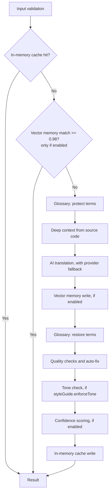

# Core Concepts

This page explains how Locai processes translations.

## Translation Pipeline

Before the pipeline runs, each batch of strings is matched to a context category (see [Context Categories](#5-context-categories)). Each string then goes through these steps in order:



Results are written to the target files after all keys of a language are processed.

## 1. Vector Memory (optional)

Vector memory is off unless you set `vectorMemory.enabled: true`. When it is on, Locai creates an OpenAI embedding for each source string and stores the translation in a local vector database (`vectorDbPath`). Before translating a string, it looks for a stored one with similar meaning for the same target language:

- Similarity ≥ `exactMatchThreshold` (default 0.98): the stored translation is reused and no translation call is made.
- Similarity ≥ `similarityThreshold` (default 0.85): the stored translation is given to the model as a reference; the translation call still happens.

Only OpenAI embeddings are supported (`embeddingProvider: "openai"`), so `OPENAI_API_KEY` must be set. With any other provider, vector memory does nothing. Each new string costs at least one embedding request. The database uses 1536-dimension vectors, which matches `text-embedding-3-small` (the default model); models with a different output size do not work.

## Deep Context (Source Code Analysis)

LocAI can look up where each key is used in your source code and send that usage with the translation request, so the model can tell a button label from a tooltip or an error message.

It reads the `.ts` and `.tsx` files under `src/`, `app/` and `components/` (relative to the directory you run LocAI from) and looks for calls like `t("cart.checkout")` or `i18n.t("cart.checkout")` whose first argument is a string literal equal to the key (nested keys in dot notation).

For each key it finds, the translation prompt gets a source code context section with:

- **File and line** of the call.
- **Component**: the enclosing function or class whose name starts with an uppercase letter (being in a `DeleteModal` rather than a `SuccessToast` changes the tone), otherwise the nearest named function.
- **Comments** (up to 3, nearest first, 200 characters each): comments right above the call, its JSX attribute, its statement or the JSX elements around it, such as `// context: shown to admin users` or `{/* context: destructive action */}`, and the comment above its component. Tooling directives such as `eslint-disable-next-line` are left out.
- **Props** (up to 10, values cut to 100 characters): the attributes of the JSX element the text belongs to, e.g. `variant="danger"` for `<Button variant="danger">{t("delete")}</Button>`.
- **Code**: up to 200 characters of the code around the call, comments removed.

When a key is used in several places, the first usage that has a comment is sent, otherwise the first usage. Keys that are not found get no extra context. This information goes to your AI provider together with the text. Set `deepContext: false` (or pass `--no-deep-context`) to skip the scan.

## 2. Smart Synchronization

Locai stores a SHA-256 hash of each source string in `.localize-cache/localization.state.json` (`syncOptions.stateTracking`). On each run it compares the source file with these hashes. A key is translated when:

- it is missing from the target file, or
- its source text changed since the last run, or
- you pass `--force` (all keys are translated again).

Keys that were removed from the source file are removed from the target files (`syncOptions.removeDeletedKeys`, on by default).

**Example:**

- You have 500 translated keys.
- You add 3 new keys and change 1 existing key.
- Locai sends only these 4 keys to the AI, not 504.

The state file is shared by all target languages and is updated after every run. If you change a source string and run only some targets, the other targets keep their old translation of it; run them with `--force` to update them. Deleting `.localize-cache` resets change tracking: on the next run, keys missing from target files are still translated, but source text changed since the previous run is not detected.

## 3. Confidence Scoring & Quality Checks

Locai performs automated checks to prevent broken apps, and can score each translation so you know which ones to look at.

### Confidence Scoring

Scoring is off by default. Turn it on with `confidenceScoring.enabled: true` in the config, or with `--min-confidence <0-1>` or `--save-review-queue`.

Each new translation from the provider then gets a **confidence score (0.0 - 1.0)**, computed from the translation itself (the model's own confidence is not used). The score starts at 1 and loses:

- 0.4 for each problem that breaks or invalidates the text: a placeholder or HTML tag count different from the source, text identical to the source, leftover model commentary ("Here is the translation: ..."), an empty or one-character result
- 0.2 when the length is under 30% or over 300% of the source
- 0.1 when the ending punctuation differs from the source

It is then scaled by fixed factors for the content category (e.g. legal), the language pair and the provider. One serious problem puts a translation below 0.7; two put it below 0.5. The score is taken before Locai's automatic fixes, so a translation whose placeholder had to be re-inserted is still flagged.

| Score                                    | What happens                                                          |
| ---------------------------------------- | --------------------------------------------------------------------- |
| at or above `autoApproveThreshold` (0.9) | Written and marked auto-approved                                      |
| below `minConfidence` (0.7)              | Written and flagged for review                                        |
| below `rejectThreshold` (0.5)            | Rejected: not written, so the key is translated again on the next run |

`--min-confidence` sets `minConfidence` for one run. `reviewThreshold`, the older name of `confidenceScoring.minConfidence`, still works; when both are set, the higher one applies.

At the end of a run Locai prints how many translations were scored, auto-approved, flagged and rejected. With `--save-review-queue` (or `confidenceScoring.saveReviewQueue: true`) the flagged and rejected translations are added to `.localize-cache/review-queue.json`; otherwise the first 20 are listed in the output. When a key is translated again, its new result replaces the queued one.

`locai review` steps through that queue: approve a translation or edit it, and it is written to the file `locai translate` writes that language to (`<localesDir>/<language>.json`, or `<localesDir>/<language>/translation.json` when the source is `<localesDir>/<source>/translation.json`) and leaves the queue; skipped ones stay queued for the next review. Translations reused from vector memory are not scored.

### Example: Quote Balance Fix

The quote balance check closes a quote the model left open. It works on the translated text only; it is not a JSON repair step.

**Scenario:**

- Source: `"Part 2: 'Go to settings'"`
- Bad Translation: `"Bölüm 2: 'Ayarlara git"` (Missing closing quote)
- **Locai Auto-Fix**: `"Bölüm 2: 'Ayarlara git'"`

## 4. Glossary Support

Ensure brand consistency by defining immutable terms.

### Before/After

**Without Glossary:**

> Source: "Welcome to the **Locai Dashboard**."
> Translation: "Locai Gösterge Paneline hoş geldiniz." (Generic translation)

**With Glossary:**

> Configuration: `glossary: { glossary: { Dashboard: { tr: "Kontrol Merkezi" } } }`
> Translation: "Locai **Kontrol Merkezi**ne hoş geldiniz." (Brand consistent)

## 5. Context Categories

You can give the model extra instructions for certain kinds of text. Define categories in `context.categories`, each with a list of keywords and a prompt. There are no built-in categories; with no categories defined, every string gets the fallback prompt (`context.fallback`).

```typescript
context: {
	categories: {
		ui: {
			keywords: ["button", "click", "menu", "screen"],
			prompt: "Keep UI terms short and consistent",
		},
	},
},
```

Matching is by keywords: a category is chosen when a string contains at least `detection.threshold` (default 2) of its keywords and the category wins at least `detection.minConfidence` (default 0.6) of the total score. "Click the button" matches `ui` above; a single word such as "Home" never matches.

With `context.useAI: true` (default `false`), strings of at least `minTextLength` characters (default 50) whose keyword match is weak are classified by an AI provider instead. This costs extra API calls.
